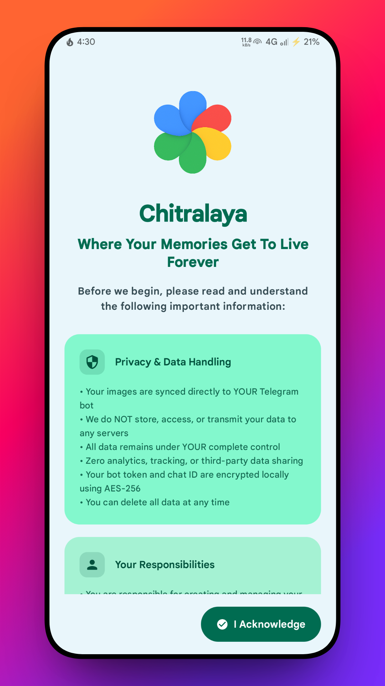
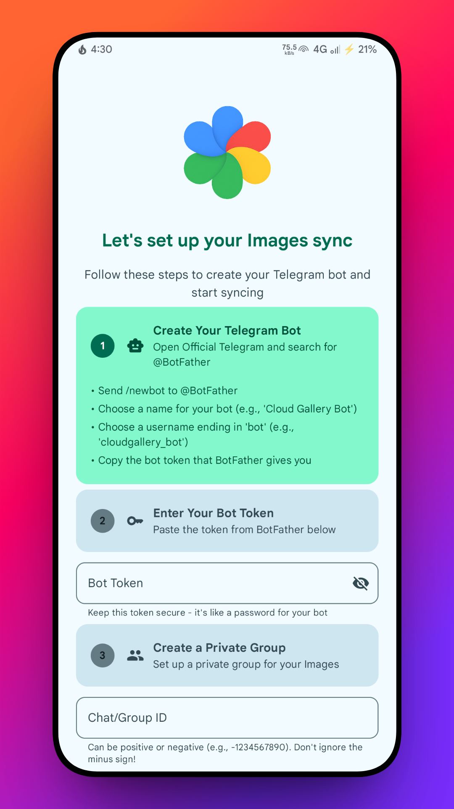
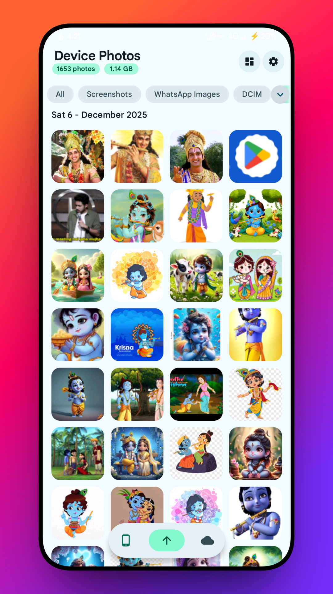
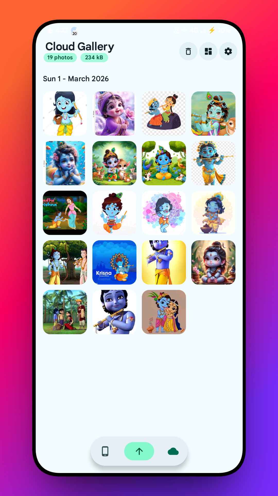
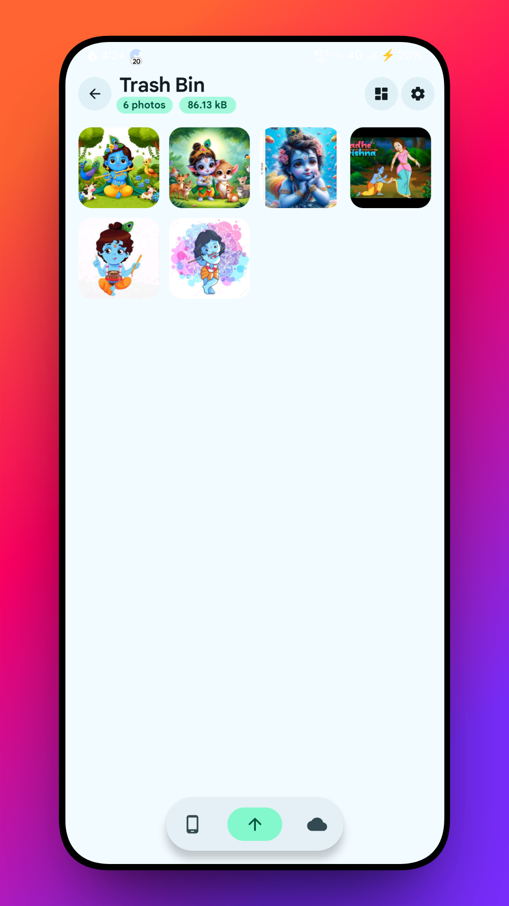
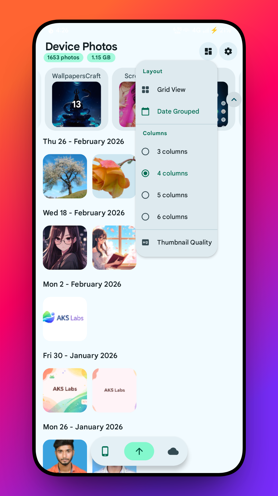

<!-- ---------- Header ---------- -->

  
  <h1>Chitralaya CloudGallery</h1>
  <h4><em>"Chitralaya" ((चित्रालय)) = "House of Images" in Sanskrit</em></h4>
  <h3>🚀 Your Personal Photo Vault with Unlimited Cloud Storage</h3>
  
<strong>Transform Telegram into your private, unlimited photo backup solution!</strong>

  
🔒 <em>100% Private • No Telemetry • Your Data, Your Control</em>

<!-- ---------- Badges ---------- -->
  

    <!--  -->
    <!--  -->
    
    
    <!--  -->
     

  

  

<!-- ----------   Labels ---------- -->

  
  
  
  

---

## 🌟 What is CloudGallery?

**Chitralaya CloudGallery** is an open-source Android application that turns your Telegram account into a private photo and video cloud storage — no third-party signup, no intermediate servers, and no telemetry.

Your media is transmitted straight from your phone to your own private Telegram channel or group, providing free, unlimited backup space with full control over your data.

> **Original Work Attribution**: This project is originally derived from and built upon the foundational open-source architecture of the **[Whitehole](https://github.com/beradeep/whitehole/)** project created by **Deep Bera ([@beradeep](https://github.com/beradeep))**, made available under the Apache License 2.0. We gratefully acknowledge and credit Deep Bera's pioneering work in transforming Telegram into an Android photo backup solution.

---

## 👋 Hey there!

I’m **Aditya**, the guy behind **AKS-Labs**.

Before you scroll, let me make one thing clear —

I’m just another user like you, tired of the usual _“cloud storage deal”_ — free at first,  
then you pay with your money... or even worse, with your privacy.

So I built something different — **Chitralaya CloudGallery**.

- It’s not a company, not a service.
- Just a simple, open-source tool —

a bridge between your Android phone 📱 and your Telegram account 📡.

---

## 🤔 Why even build this?

I was using Google Photos like everyone else. Free storage, nice features, AI magic… but then I realized:

- Google scans my photos to “offer me memories” → which also means they _read_ them.
- Google uses user data to personalize services, show relevant ads, improve products,services.
- We users don’t even know or read what other privacy-concerning terms we’ve agreed to at the time of sign-up.
- And will they only use data collected from Google Photos to improve Google Photos — or does it include all Google products?
- Sharing a link doesn’t mean it’s private — anyone with that link can see your photos.
- Needs to compress images when free storage is full.
- One day, “free storage is full” and they said: “Pay up for more storage.”

Google, builds entire business models around data.

That’s when it hit me: my photos aren’t _mine_.

I wanted something unlimited, private, and mine.
And then I looked at Telegram.

---

## 🔒 Privacy, Security & Telegram Architecture

**Transparency First**: GallerySync is an open-source backup tool designed to give you direct control of your media without intermediary third-party clouds. To make an informed decision, here is exactly how media transfer, storage, and privacy operate:

### 1. Direct Transmission via Telegram Bot API

- All photos and videos are transmitted directly from your Android device to Telegram’s official Bot API servers (`api.telegram.org`) over TLS/HTTPS.
- Uploads are directed exclusively to your own user-configured private channel or group.

### 2. Telegram Server Storage & Encryption Model

- **No End-to-End Encryption (E2EE)**: Ordinary Telegram Bot API channel uploads are **not end-to-end encrypted**.
- While data is encrypted in transit and stored securely on Telegram's cloud storage servers, Telegram processes and stores your media, and Telegram infrastructure holds the technical keys to process those messages.
- If you require zero-knowledge encryption where cloud providers cannot read the file data under any circumstances, note that **on-device pre-upload encryption is a planned future enhancement**, not a present capability. Today, media is uploaded in its original format.

### 3. Channel Access Boundary

- Media uploaded to your Telegram channel is accessible to **anyone with access to that channel** (channel administrators, members, or invitees).
- Keep your private channel strictly restricted to yourself (and trusted recipients you intentionally add).

### 4. Zero Intermediary Servers or Telemetry

- **No Third-Party Infrastructure**: GallerySync operates no storage servers, telemetry services, crash analytics, user accounts, or proxy infrastructure.
- The app never communicates with any third-party servers. All interactions occur solely between your device and Telegram.

### 5. Local Credential Security

- Your Telegram Bot Token, Private Channel Chat ID, and Forum Topic ID are encrypted on-device using the **Android Keystore (AES-256 GCM)** via `EncryptedSharedPreferences`.
- Credentials are never exposed in log output or sent to any server other than Telegram's official API.

### 6. Local Database & Metadata Persistence

- GallerySync uses a local **Room SQLite database** on your device to track indexed photos, upload queue states, and Telegram remote message IDs.
- For disaster recovery across reinstalls, a metadata backup can be synced to your private channel so you can restore your library index. This metadata file contains identifiers and hashes, not your photo binaries.

---

## ✨ What can it do today?

- 📸 Unlimited photo backup → via your Telegram bot
- 🔄 Smart sync → detects changes automatically
- 🎨 Modern Material 3 UI → clean, minimal, simple
- 📱 Database import/export → restore your photo history across devices
- 🖼️ Browse synced photos in a proper gallery (not Telegram’s clunky file view)
- 🔒 Strong key storage for tokens

---

## 🔮 What can it do tomorrow?

Here’s where you come in. CloudGallery is community-powered. With your support, I want to add:

- 📤 Batch Upload & Delete
- 🌙 Auto Sync at Bedtime
- 📆 Control How Many Photos to Back Up Per Day (e.g. 40 images/day)
- ⏰ Schedule Time for Auto Periodic Backup (e.g. between 12 AM – 6 AM)
- 📂 Folder-Specific Uploads
- ☁️ Organized Folder Structure for Cloud Images
- 🖼️ Share Images from Any App to Chitralaya CloudGallery to Upload Them Directly to Telegram via Chitralaya
- 🧠 100% Offline On-Device OCR Search (Find Photos by Text Inside Them)
- 🤖 Multiple Bot Support
- 🔐 **On-device encryption layer** → so even Telegram can’t peek into your files
- ✨ Even smoother Material 3 experience
- 💡 And honestly… whatever _you_ suggest in the Telegram group

These aren’t “marketing slides”. They’re real ideas sitting in my notes, waiting for time and [**Support**](https://github.com/sponsors/AKS-Labs).

---

## ❤️ Final Words

I’m not a company. I’m not trying to “capture market share.”
I’m just one developer building something I wanted for myself — and thought others might find useful.

If you like CloudGallery and want to see it grow:

- ⭐ Star the repo
- 💬 Join the [AKS-Labs Telegram group](https://t.me/AKSLabs)
- ☕ Maybe [**Donate**](https://github.com/sponsors/AKS-Labs), if you can.

At the end of the day, this is about choice.
If you don’t like it, you lose nothing.
If you do, you gain control over your memories.

Your photos, your choice.

---

## 📥 **Get Chitralaya CloudGallery**

    

  
  
   
  
<strong>• 🔓 Open Source    • 🚀 Ready to Use</strong>

---

## 🚀 **Quick Setup**

### 🤖 **Step 1: Create Telegram Bot**

1. Open Telegram → Search `@BotFather`
2. Send `/newbot` → Follow prompts
3. Copy your bot token 🔑
4. Create private group → Add bot → Type `/start` → Get chat ID
    - Usually, the **chat ID** will appear automatically.
    - If it **doesn’t**, click below for the alternate method 👇

🔍 How to Find Chat ID (Alternate Method)👇

1.  Go to **[web.telegram.org](https://web.telegram.org)** and log in.
2.  Open the **group** where you added your bot.
3.  Look at your browser’s **address bar (URL)** — you’ll see something like:

          https://web.telegram.org/k/#123456789

4.  The number after the `#` is your **Group ID** → `123456789`.
5.  Add `-100` in front to use it with the **Bot API**:

         -100123456789

6.  That’s your full **chat_id** ✅  
    Use it inside the app or in your API.

---

### 📱 **Step 2: Connect the App**

1. Download **CloudGallery** from GitHub.
2. Enter your **bot token** and **chat ID**.
3. Start backing up your photos! 🎉

---

💬 **Need help?**  
Join the community → [t.me/AKSLabs](https://t.me/AKSLabs)

---

## 📱 **Screenshots**

  
  
  

  
  
  

---

## 🤝 **Community**

- 🐛 **Bug reports:** [GitHub Issues](https://github.com/AKS-Labs/CloudGallery/issues)
- 💡 **Feature requests:** [GitHub Issues](https://github.com/AKS-Labs/CloudGallery/issues)
- 👨‍💻 **Contribute:** Fork and submit pull requests
- ⭐ **Show support:** Star the repository!

---

## 🙏 **Credits & Attribution**

This project is built on the foundations and contributions of the open-source community:

- **[Whitehole](https://github.com/beradeep/whitehole/)** by **Deep Bera ([@beradeep](https://github.com/beradeep))**:
    - **Original Work & Architecture**: The core concept, early MediaStore indexing implementation, and Room database architecture (`wh_database`) were originally authored and open-sourced by Deep Bera in the Whitehole project.
    - **License**: Derived under the terms of the [Apache License, Version 2.0](LICENSE-APACHE-2.0.md).
    - We express our sincere gratitude to Deep Bera for creating and sharing the foundational codebase.
- **[kotlin-telegram-bot](https://github.com/kotlin-telegram-bot/kotlin-telegram-bot)**:
    - Kotlin wrapper library for Telegram Bot API communication and command dispatching.
- **Google Material Design**:
    - [Material Icons](https://material.io/resources/icons/) and Material 3 design system for UI components.
- **Android Jetpack & Libraries**:
    - Jetpack Compose, Room Database, WorkManager, OkHttp, Retrofit, and Coil.

---

  <h3>🔒 **Your Photos. Your Privacy. Your Control.** 🔒</h3>
  
<strong>Experience unlimited photo backup without compromising your privacy!</strong>

  <a href="https://github.com/AKS-Labs/CloudGallery/releases">
    <strong>📥 Download CloudGallery Today!</strong>
  </a>

